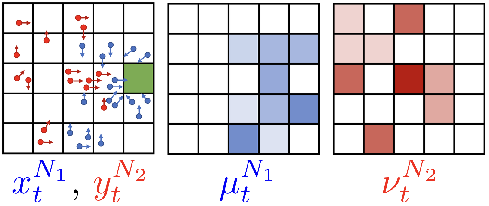

# MF-Env

MF-Env is a Gymnasium-compatible collection of mean-field multi-agent environments for reinforcement-learning research. Environments model populations of agents whose rewards and transitions can depend on population-level state.

## Environments

| Gymnasium ID | Scenario | Description |
| --- | --- | --- |
| `gym_mf_envs/MF-RPSMFEnv-v0` | Constrained Rock-paper-scissors | A mean-field benchmark for the constrained rock-paper-scissors game. |
| `gym_mf_envs/MF-Battle-v0` | Battlefield | Competing populations (finite population) move through a grid and interact with targets. |
| `gym_mf_envs/MF-Virus-v0` | Virus | Populations move through a grid with health dynamics, representing the epidemiology game |
| `gym_mf_envs/MF-Nav-v0` | Grid navigation | Populations navigate a grid containing targets and obstacles |
| `gym_mf_envs/MF-Battle-Infinite-v0` | Infinite battlefield | Infinite population (oracle dependent) version of the competitive battlefield scenario. |
| `gym_mf_envs/MF-Virus-Infinite-v0` | Infinite virus | Infinite population (oracle dependent) version of the epidemiology scenario. |



*Battlefield as a zero-sum mean-field team game*

## Installation

Use Python 3.8 or later. From a checkout of the repository, install the package and its declared dependencies with:

```bash
python -m pip install -e .
```

The environments are registered when `gym_mf_envs` is imported. The demos use Gymnasium and the wrappers provided by the package.

## Quick start

```python
import gymnasium as gym
import gym_mf_envs  # Registers the environments.
from gym_mf_envs.wrappers import MultiDiscreteActionWrapper

env = gym.make(
    "gym_mf_envs/MF-RPSMFEnv-v0",
    num_population=2,
    num_agent_dict={"blue": 3, "red": 3},
)
env = MultiDiscreteActionWrapper(env)
observations, info = env.reset(seed=0)
actions = env.action_space.sample()
observations, rewards, terminated, truncated, info = env.step(actions)
env.close()
```

Environment configuration is passed through `gym.make`. Grid scenarios typically accept per-population agent counts, action maps, grid size, target and obstacle settings, and optional rendering configuration. See the constructor signatures in `gym_mf_envs/envs/grid_envs/envs/` for scenario-specific options.

## Demo notebook

Run [`examples/mf_envs_demo.ipynb`](examples/mf_envs_demo.ipynb) in Jupyter. It explains and runs the finite scenarios sequentially: battlefield, grid navigation, rock-paper-scissors, and virus. Rendering is disabled in the notebook so it can run in headless environments.

## Wrappers

The wrappers in `gym_mf_envs.wrappers` adapt the multi-population interfaces for common training setups:

- `MultiDiscreteActionWrapper` converts the joint multi-agent action space into a multi-discrete action space.
- `FlattenObservationWrapper` flattens structured observations.
- `PopulationRewardWrapper` aggregates agent rewards by population.
- `AnyPopulationAllAgentDoneWrapper` ends an episode when every agent in any population is done.
- `AllDoneWrapper` ends an episode when all agents across populations are done.
- `CompleteObservationStructureWrapper` standardizes the observation structure.
- `ParallelRewardWrapper` provides rewards in a parallel multi-agent format.
- `AllDoneInfiniteWrapper` provides termination handling for infinite-population environments.

## API notes

The environments follow the Gymnasium reset and step conventions. `reset` returns `(observation, info)` and `step` returns `(observation, reward, terminated, truncated, info)`. Population and agent data are keyed by population identifiers such as `"blue"` and `"red"`. The finite environments represent individual agents; the infinite variants represent population distributions.

## Project layout

- `gym_mf_envs/envs/` contains environment implementations, mean-field oracles, grid simulation utilities, and rendering helpers.
- `gym_mf_envs/wrappers/` contains observation, action, reward, and termination wrappers.
- `examples/mf_envs_demo.ipynb` contains the ordered scenario walkthrough.

## Citation

If you use MF-Envs in your research, please cite:

```bibtex
@misc{jeloka2026learninglargescalecompetitiveteam,
      title={Learning Large-Scale Competitive Team Behaviors with Mean-Field Interactions and Online Opponent Modeling},
      author={Bhavini Jeloka and Yue Guan and Panagiotis Tsiotras},
      year={2026},
      eprint={2504.21164},
      archivePrefix={arXiv},
      primaryClass={cs.MA},
      url={https://arxiv.org/abs/2504.21164},
}
```
